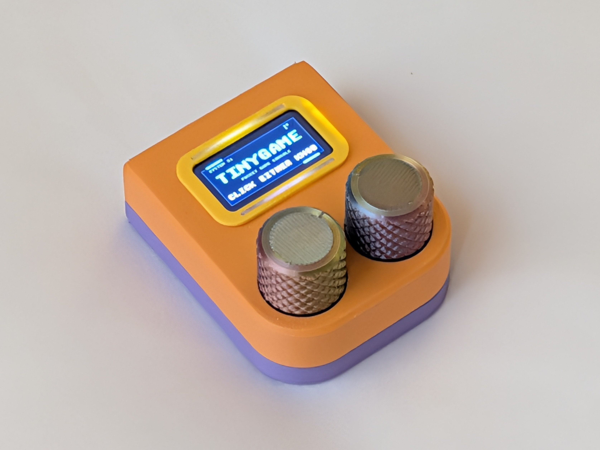
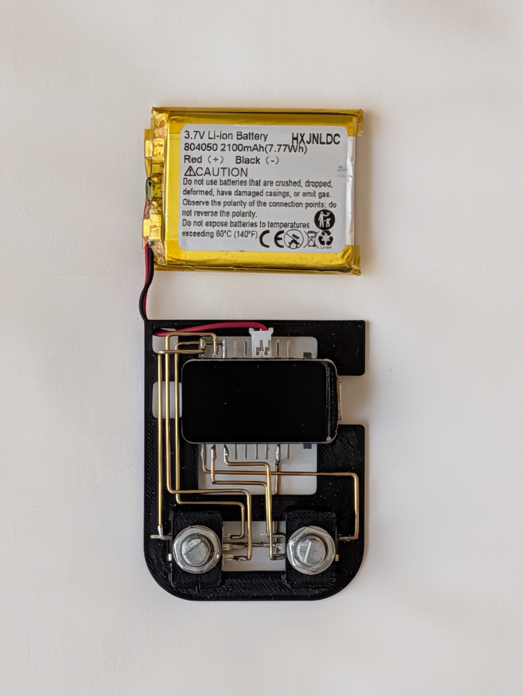
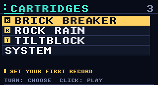
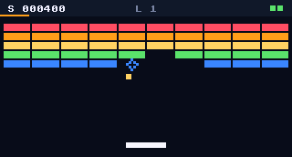
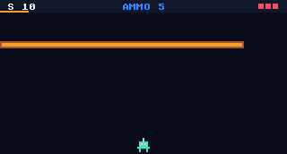

# TinyGame
**Tiny screen. Twisty knobs. Real games, built by you.**

TinyGame is a pocket-sized game console you build and an AI agent setup you use to create your own games. Boot up your favourite coding agent, describe the game you want, push it to the platform, play it, tweak it, share it.

No D-pad, no buttons, no shortcuts, and no internet: TinyGame has two clicky knobs, a motion sensor, and a tiny screen. Designed by a tech educator and parent as a platform for kids (and growns) to learn how to build engaging gameplay within constraints that boost creativity.

- Describe the game you want
- Explore how twists, clicks, and tilts add to the gameplay
- Turn your idea into a real playable game and share it with the world

Powered by an ESP32-S3, fueled by your imagination. What will you build first?

What TinyGame will you build?

<p align="right">
  
  
</p>

## Playing

- **Turn the right knob** to choose; **click either knob** to open, **hold either** to go back. Left-handed? Set **System > Settings > HANDEDNESS** to LEFT and the left knob takes over. Menus stop at their ends instead of wrapping.
- In any game, **hold either knob** to pause: Resume, Restart or Quit.
- Game cartridges all use yellow badges and highlights; the filled yellow row is the selected game.
- **Hold both knobs together for 3 seconds** to ask **SLEEP?** from any game or menu. Release both, then click to confirm **YES**, or turn the main knob to **NO** and click to keep playing. The prompt pauses a running game; **NO** restores your game or menu without losing progress. A single-knob hold also cancels the prompt.
- **System** (the last item in the game list) has Settings (screen and LED brightness, handedness, auto-off), Diagnostics (live knob, switch and tilt readings), the Style preview and Sleep. On Diagnostics, clicks stay on the page so you can inspect them; **hold either knob** to exit.
- **Sleep:** System > Sleep, or 5 minutes without knob activity by default (even in a game), enters deep sleep. In System > Settings, set **AUTO-OFF** to ON or OFF and **OFF AFTER** to **1, 5, 10, 15 or 30 minutes**. Click either knob to wake to the welcome screen. That restarts the console, not the previous game. Saved scores and confirmed settings stay saved.
- **Using a computer:** An open USB CDC serial connection (for example, the serial monitor or simulator controller) suspends auto-off. USB power alone, including a computer with no open serial connection, does not. Closing the connection starts a fresh idle countdown. System > Sleep still works while connected.
- **Firmware:** The welcome screen shows a friendly release number, such as **Firmware 1.0.0**. Firmware and simulator share `TG_FIRMWARE_VERSION` in `include/tg_os_version.h`. Maintainers bump that single value for OS releases: **MAJOR** for breaking changes, **MINOR** for backward-compatible features, **PATCH** for backward-compatible fixes. Builds and source edits do not automatically increment it.
- **Plugged-in light:** The unmodified board has no software-readable USB power signal, so the RGB light keeps its existing game/menu behavior rather than claiming to indicate every USB cable or charger. The separate charger light is hardware-controlled. See [USB power and lights](docs/wiring.md#usb-power-and-lights).

The knobs turn continuously without detents. Firmware measures electrical movement: nominally 80 steps per turn, with four per menu item. Games steer with the main knob using the shared `tg::Steer` + `tg::glide` controls, and a click on either knob is the action button.

### Screenshots

The launcher and three games are currently included: Brick Breaker, Rock Rain,
and TiltBlock. TiltBlock is an isometric cube puzzle where the ball rolls
as you tilt the console or turn the two knobs.

| Launcher | Brick Breaker |
|---|---|
|  |  |

| Rock Rain |
|---|
|  |

## Testing the controls

With the board connected, flash it and drive Diagnostics from the computer. The first `send` opens Diagnostics from the welcome screen without touching a knob (HANDEDNESS = RIGHT; with LEFT, use `turn left` in it):

```bash
python3 tools/tg.py flash
python3 tools/tg.py send click "turn right 1000" click "turn right 4" click
python3 tools/tg.py send "turn left 8" "turn right -8" "click left" "click right" "log on"
python3 tools/tg.py monitor -s 10
python3 tools/tg.py shot
```

`turn` is in signed electrical transitions (positive is clockwise). `click`, `hold`, `down` and `up` take `left` or `right` (default left). `down` stays held until `up`, and `hold` sends a long-press event.

On Diagnostics, the `L/R HW` rows show physical counts and A/B levels. `C` is total clicks, `ERR` invalid transitions and `O` counter overflows. Totals and last events stay until another event or a reboot. The `E L/R` rows add simulated input to the physical readings, and simulation never changes the physical rows. The tilt dot shows the IMU.

**Check by hand:**

- Rotate and click each knob alone and together.
- Mark a shaft position and count one full turn (nominally 80), and check that clockwise is positive. Direction constants are in `src/hal/board_config.h`.
- Reverse slowly and quickly, and turn during a screenshot. A single-channel bounce can briefly move the count back and forth; persistent drift or a rising `ERR` needs investigation.
- Choose System > Sleep, then wake with each knob click on its own. Also leave the console idle for 5 minutes in a menu and in a game with no serial connection open; test the other timeout options and AUTO-OFF = OFF.
  - Turning, clicking or holding either knob (or simulating it) resets the idle timer; tilt doesn't. An active USB serial host suspends auto-off, and closing it restarts the countdown. A held switch prevents sleep.
  - Keep the serial monitor open beyond the timeout and confirm the console stays awake. Close it (USB power can stay connected) and confirm auto-off works. Manual Sleep must still work with the monitor open.
  - Both switches must be released before shutdown. The wake press is swallowed, so holding it through startup selects nothing. Turning or serial commands can't wake the board.
  - Screen, backlight and RGB LED stay off while asleep. USB may disappear, so reconnect the monitor after waking.
  - Deep sleep isn't a physical power disconnect. Measure whole-board current instead of assuming a chip-datasheet number.

## Making a game

Open this folder in GitHub Copilot, Claude Code or Codex, and say what you want:

> "Make a game where you tilt the console to roll a marble around obstacles, and clicking opens doors."

The agent uses the `make-a-game` skill. It creates `src/games/<your_game>/`, then builds and tests it, and the game appears in the menu automatically. With the console plugged in, it can also flash the game and check screenshots. Without one, use the browser simulator as well as the host tests.

Doing it by hand:

```bash
python3 tools/tg.py new marble "MARBLE RUN"
python3 tools/tg.py flash
```

Then edit `src/games/marble/game.cpp`.

## Simulator

**No console needed to start making games.** Play and test the real firmware in
a browser, then try it on the console when you're ready. In GitHub Copilot,
ask: **"Open the TinyGame simulator and launch Brick Breaker."** In any other coding
tool, or to play without an agent:

```bash
python3 tools/tg.py sim                # build, serve locally and open a browser
python3 tools/tg.py sim --no-open      # print the URL without opening it
python3 tools/tg.py sim --port 8080    # choose the local HTTP port
python3 tools/tg.py sim --build-only   # compile WebAssembly only
```

The simulator build needs macOS or Linux (Windows: use WSL), Python 3.10+,
Git, curl and Node.js 22+. On first use the helper installs a pinned
Emscripten SDK in your user cache, outside the repository; it uses LVGL 9.6.0
from PlatformIO when available, otherwise downloads a pinned cached copy.
PlatformIO is not required just to run the simulator.
Allow time and disk space for the first download/build. Later builds reuse
compiled objects. Source edits rebuild and reload automatically, and compile
errors appear on the page. Nothing is published to the internet.

The simulator draws the screen, two knobs and RGB LED. It runs the same OS,
menus and games as the console; new game folders work automatically.

| Knob | Clockwise | Click | Counterclockwise |
|---|---|---|---|
| Left | D | S | A |
| Right | L | K | J |

Tap a turn key for one menu step; hold it to repeat. Hold S or K for the
console's pause/back action. With a mouse, drag a knob's rim or scroll over it
to turn, and press its centre to click or hold. Drag the screen or use arrow
keys to tilt; releasing returns to level. Settings and best scores persist in
browser storage. Sleep wakes to a fresh boot when you click a knob, like the
real console. Click the page before using keys; typing in the dev command
field does not turn the knobs.

The **TinyGame simulator** canvas is included as a project extension for the
GitHub Copilot app. Ask your agent to open it; it can launch games, send dev
commands and save screenshots. See the [canvas guide](.github/extensions/tinygame-simulator/README.md)
for actions and setup. The normal browser has a serial log, dev command field
and Screenshot button; standalone screenshots go to `sim/screenshots/`.

### Try a change

Start `tg.py sim`, open a game, and edit its files in `src/games/<id>/`.
The running simulator rebuilds and reloads when you save. Reload starts a
fresh run, so don't rely on it keeping your current game or level. If a build
fails, the page shows the error and keeps the previous working firmware;
fix the error before treating the preview as your latest code.

Expand **Serial log** to see game logs and send dev commands. For example,
send `launch brickbreaker`, then `click` to launch the ball, or `launch rockrain`,
then `turn right 8` to move. Send each command separately. Return an
injected tilt to level with `tilt off`; release any held input with `up left`
and `up right`. The canvas agent can send a whole command sequence and save
a native-resolution screenshot.

Best scores and confirmed settings survive page reloads in the same browser
origin. They're separate from the physical console's saves. A different
browser or server port has separate saves; use `--port 8080` each time if you
want a consistent local-browser origin. Clearing site data resets them.

### Use the physical console as a controller

After flashing firmware with controller support once, enable **Use connected
console** on the simulator. Physical knob turns, clicks, holds and accelerometer
tilt control the browser while the board shows **CONTROLLING SIMULATOR**.
Its own menus and games are paused and idle sleep is suspended. Browser controls
still work. Disconnecting or losing the host heartbeat restores normal operation.
If the page says **Connecting** and then reports no input, flash the current
firmware, make sure the console is awake, and reconnect. USB cannot wake a
sleeping console; click a physical knob first.

The underlying bridge can also run directly:

```bash
python3 tools/tg.py bridge [--port /dev/cu.usbmodem...]
```

**The USB port is exclusive. Disconnect the controller before running `flash`,
`send`, `shot` or `monitor`.** With multiple boards, specify the serial port
in the canvas `connect_device` action. Browser checks cannot prove physical
knob feel/direction, tilt direction, LED colours or real deep-sleep current.
The bridge forwards knobs and tilt, not raw accelerometer or gyro samples:
shake, flick and spin gestures still need the real game running on the board.

## Sharing a game

A game is just its folder. To share one, commit `src/games/<id>/` and open a pull request, or send the folder to a friend to drop into their own `src/games/`. Each folder has a `README.md` with how to play and who made it.

## Setup and agent support

Install Python 3, a C++17 compiler (`c++`, or set `CXX`) and PlatformIO, then check that everything works:

```bash
python3 -m pip install platformio
python3 tools/tg.py test
python3 tools/tg.py build
```

PlatformIO supplies the firmware toolchain and the Python serial library. Use your platform's supported Python environment (a virtual environment is fine). `test` and `build` need no board; `flash`, `send`, `shot` and `monitor` do. When several boards are connected, add `--port <device>` to those four.
For simulator-only play, use the requirements in [Simulator](#simulator)
instead. USB controller mode additionally needs the Python `pyserial` package
(supplied by PlatformIO, or installed in your Python environment).

| Harness | Project guidance | Skills |
|---|---|---|
| GitHub Copilot | `.github/copilot-instructions.md` points to `AGENTS.md` | `.claude/skills/` (also visible under `.agents/skills/`) |
| Claude Code | `CLAUDE.md` imports `AGENTS.md` | `.claude/skills/` |
| Codex | `AGENTS.md` | `.agents/skills/`, symlinks to the same skills |

Use a current harness version with Agent Skills support, and check that its skill list shows `make-a-game` and `waveshare-esp32-s3-lcd-147b`. The skills live only in `.claude/skills/`; don't copy them between harness directories.

On Windows, enable symlinks (for example Developer Mode and Git's `core.symlinks=true`) **before cloning**. A checkout that turns the links into plain text hides the Codex skills; until that's fixed, ask the agent to read `.claude/skills/<name>/SKILL.md` directly.

## For grown-ups

- **Hardware:** Waveshare ESP32-S3-LCD-1.47B plus two detentless EC11 rotary encoders with click switches. Pins and wiring are in [docs/wiring.md](docs/wiring.md); the pin map itself is `src/hal/board_config.h`. Both click switches wake the console from sleep. Never put more than 3.3 V on a GPIO.
- **Software:** PlatformIO, Arduino (ESP32 core 2.x), C++17, LVGL 9.6. LVGL draws through a custom blocking SPI driver, not LovyanGFX: a compile-only LovyanGFX DMA probe passed, but it would need allocation-failure handling and hardware benchmarks before adoption.
- **Visual style:** "Pocket Arcade": a dark, blocky 8-bit look with cartridge-style menu rows, pixel badges and framed score panels. The shared tokens and helpers are in `include/tg_style.h`.
- **Tooling:** `tools/tg.py` handles firmware and simulator builds, flash, host tests, USB bridging, serial monitor, input injection and screenshots. `AGENTS.md` is the guide for coding agents, and the skills are in `.claude/skills/`.
- **Architecture:**
  - `src/hal/` holds the drivers.
  - `src/os/` holds the menus, the style library, the game registry and the dev tools.
  - `src/games/` holds the games. Each game registers itself with `TINYGAME(...)`.
  - `sim/` replaces the hardware layer for WebAssembly and serves the browser UI; games and OS logic are shared, not reimplemented.
  - Input decoding, sleep safety gates, menu logic and game simulations are plain C++ with host unit tests (`python3 tools/tg.py test`).

## License

TinyGame is licensed under the [MIT License](LICENSE).
