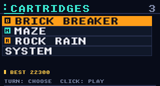
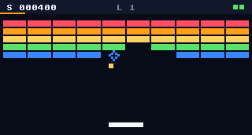
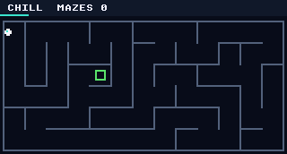
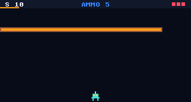

# TinyGame

A pocket game console you program by talking to a coding agent.

It has one screen (320×172), two smoothly turning knobs with click switches, and a motion sensor. No third button. Small limits, big ideas.

## Playing

- **Turn the right knob** to choose; **click either knob** to open, **hold either** to go back. Left-handed? Set **System > Settings > HANDEDNESS** to LEFT and the left knob takes over. Menus stop at their ends instead of wrapping.
- In any game, **hold either knob** to pause: Resume, Restart or Quit.
- **System** (the last item in the game list) has Settings (screen and LED brightness, handedness), Diagnostics (live knob, switch and tilt readings), the Style preview and Sleep. On Diagnostics, clicks stay on the page so you can inspect them; **hold either knob** to exit.
- **Sleep:** System > Sleep, or 3 minutes without knob activity (even in a game), enters deep sleep. Click either knob to wake to the welcome screen. That restarts the console, not the previous game. Saved scores and confirmed settings stay saved.

The knobs turn continuously (the detents were removed). Firmware measures electrical movement: nominally 80 steps per turn, with four per menu item. Games steer with the main knob using the shared `tg::Steer` + `tg::glide` controls, and a click on either knob is the action button.

### Screenshots

The launcher and the three games currently included:

| Launcher | Brick Breaker |
|---|---|
|  |  |

| Maze | Rock Rain |
|---|---|
|  |  |

## Testing the controls

With the board connected, flash it and drive Diagnostics from the computer. The first `send` opens Diagnostics from the welcome screen without touching a knob (HANDEDNESS = RIGHT; with LEFT, use `turn left` in it):

```bash
python3 tools/tg.py flash
python3 tools/tg.py send click "turn right 1000" click "turn right 4" click
python3 tools/tg.py send "turn left 8" "turn right -8" "click left" "click right" "log on"
python3 tools/tg.py monitor -s 10
python3 tools/tg.py shot
```

`turn` is in signed electrical transitions (positive is clockwise). `click`, `hold`, `down` and `up` take `left` or `right` (default left). `down` stays held until `up`, and `hold` sends a long-press event.

On Diagnostics, the `L/R HW` rows show physical counts and A/B levels. `C` is total clicks, `ERR` invalid transitions and `O` counter overflows. Totals and last events stay until another event or a reboot. The `E L/R` rows add simulated input to the physical readings, and simulation never changes the physical rows. The tilt dot shows the IMU.

**Check by hand:**

- Rotate and click each knob alone and together.
- Mark a shaft position and count one full turn (nominally 80), and check that clockwise is positive. Direction constants are in `src/hal/board_config.h`.
- Reverse slowly and quickly, and turn during a screenshot. A single-channel bounce can briefly move the count back and forth; persistent drift or a rising `ERR` needs investigation.
- Choose System > Sleep, then wake with each knob click on its own. Also leave the console idle for 3 minutes in a menu and in a game.
  - Turning, clicking or holding either knob (or simulating it) resets the idle timer; tilt and serial monitoring don't. A held switch prevents sleep.
  - Both switches must be released before shutdown. The wake press is swallowed, so holding it through startup selects nothing. Turning or serial commands can't wake the board.
  - Screen, backlight and RGB LED stay off while asleep. USB may disappear, so reconnect the monitor after waking.
  - Deep sleep isn't a physical power disconnect. Measure whole-board current instead of assuming a chip-datasheet number.

## Making a game

Open this folder in GitHub Copilot, Claude Code or Codex, and say what you want:

> "Make a game where you tilt the console to roll a marble through a maze, and clicking opens doors."

The agent uses the `make-a-game` skill. It creates `src/games/<your_game>/`, then builds and tests it, and the game appears in the menu automatically. With the console plugged in, it can also flash the game and check screenshots. Without one, you can still develop and run the host tests.

Doing it by hand:

```bash
python3 tools/tg.py new marble "MARBLE MAZE"
python3 tools/tg.py flash
```

Then edit `src/games/marble/game.cpp`.

## Sharing a game

A game is just its folder. To share one, commit `src/games/<id>/` and open a pull request, or send the folder to a friend to drop into their own `src/games/`. Each folder has a `README.md` with how to play and who made it.

## Setup and agent support

Install Python 3, a C++17 compiler (`c++`, or set `CXX`) and PlatformIO, then check that everything works:

```bash
python3 -m pip install platformio
python3 tools/tg.py test
python3 tools/tg.py build
```

PlatformIO supplies the firmware toolchain and the Python serial library. Use your platform's supported Python environment (a virtual environment is fine). `test` and `build` need no board; `flash`, `send`, `shot` and `monitor` do. When several boards are connected, add `--port <device>` to those four.

| Harness | Project guidance | Skills |
|---|---|---|
| GitHub Copilot | `.github/copilot-instructions.md` points to `AGENTS.md` | `.claude/skills/` (also visible under `.agents/skills/`) |
| Claude Code | `CLAUDE.md` imports `AGENTS.md` | `.claude/skills/` |
| Codex | `AGENTS.md` | `.agents/skills/`, symlinks to the same skills |

Use a current harness version with Agent Skills support, and check that its skill list shows `make-a-game` and `waveshare-esp32-s3-lcd-147b`. The skills live only in `.claude/skills/`; don't copy them between harness directories.

On Windows, enable symlinks (for example Developer Mode and Git's `core.symlinks=true`) **before cloning**. A checkout that turns the links into plain text hides the Codex skills; until that's fixed, ask the agent to read `.claude/skills/<name>/SKILL.md` directly.

## For grown-ups

- **Hardware:** Waveshare ESP32-S3-LCD-1.47B plus two detentless EC11 rotary encoders with click switches. Pins and wiring are in [docs/wiring.md](docs/wiring.md); the pin map itself is `src/hal/board_config.h`. Both click switches wake the console from sleep. Never put more than 3.3 V on a GPIO.
- **Software:** PlatformIO, Arduino (ESP32 core 2.x), C++17, LVGL 9.6. LVGL draws through a custom blocking SPI driver, not LovyanGFX: a compile-only LovyanGFX DMA probe passed, but it would need allocation-failure handling and hardware benchmarks before adoption.
- **Visual style:** "Pocket Arcade": a dark, blocky 8-bit look with cartridge-style menu rows, pixel badges and framed score panels. The shared tokens and helpers are in `include/tg_style.h`.
- **Tooling:** `tools/tg.py` handles build, flash, host tests, serial monitor, input injection and screenshots. `AGENTS.md` is the guide for coding agents, and the skills are in `.claude/skills/`.
- **Architecture:**
  - `src/hal/` holds the drivers.
  - `src/os/` holds the menus, the style library, the game registry and the dev tools.
  - `src/games/` holds the games. Each game registers itself with `TINYGAME(...)`.
  - Input decoding, sleep safety gates, menu logic and game simulations are plain C++ with host unit tests (`python3 tools/tg.py test`).
